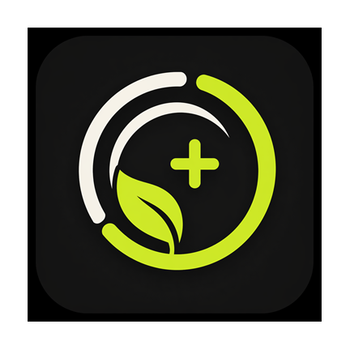
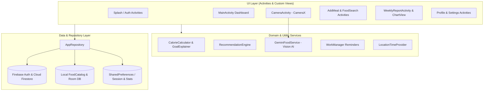

<div align="center">



# Kaloriq — AI-Powered Calorie & Nutrition Tracker

**A modern Android application for intelligent meal recognition, personalized calorie & macronutrient tracking, health-aware dietary recommendations, and real-time cloud synchronization.**

[](https://developer.android.com)
[-34A853)](https://developer.android.com/about/versions/pie)
[](https://developer.android.com)
[](https://openjdk.org/)
[](https://firebase.google.com)
[](https://ai.google.dev/)
[](https://github.com/Uguravsar75/CalorieTrackingApp/actions/workflows/android-ci.yml)
[](LICENSE)

</div>

---

## Overview

**Kaloriq (`CalorieTrackingApp`)** helps users build sustainable nutrition habits by combining scientific metabolic calculations (**Mifflin-St Jeor** equation) with multimodal AI food recognition (**Google Gemini 2.5 Flash Vision**). Users can photograph their meals for instant calorie and macronutrient estimation, search a curated catalog of **103+ foods**, receive medical-condition-aware warnings (Diabetes, Hypertension, Cholesterol), and track hydration, steps, and weekly progress across devices via **Firebase Cloud Firestore**.

---

## Key Features

- **AI Vision Meal Analysis (`Gemini 2.5 Flash`)**: Snap a photo with CameraX or pick from the gallery to automatically detect food items, portion weight (g), total calories (kcal), and macronutrients (Protein, Carbohydrates, Fat).
- **Scientific Calorie & BMR Engine**: Calculates Basal Metabolic Rate (BMR) and Total Daily Energy Expenditure (TDEE) using the **Mifflin-St Jeor** formula tailored to age, gender, height, weight, activity level, and health conditions.
- **Health-Condition-Aware Smart Coaching**:
  - **Diabetes**: Flags high-sugar items and suggests low-glycemic alternatives.
  - **Hypertension**: Alerts on high-sodium foods and recommends low-salt options.
  - **Cholesterol**: Warns against saturated/fried fats in favor of grilled proteins.
  - **Context-Aware Suggestions**: Adapts meal recommendations dynamically based on the user's location timezone, time of day, and remaining daily calorie budget.
- **Cloud-First Synchronization**: Secure authentication via **Firebase Auth** (Email/Password & Google Sign-In) and real-time cloud persistence with **Cloud Firestore**, backed by an in-memory and local catalog fallback.
- **Comprehensive Food Catalog (103+ Items)**: Pre-seeded Turkish and international dishes with category filters, accent-insensitive search, food thumbnails, and portion-to-gram conversion (`Portion`, `Gram`, `Bowl`, `Slice`, `Piece`).
- **Daily Activity & Weekly Analytics**: Track water intake (glasses), step counts, and exercise burn (kcal) alongside an interactive 7-day custom chart (`WeeklyChartView`) and AI-generated weekly nutrition summaries.
- **Smart Background Reminders**: Scheduled meal and hydration notifications powered by **Android WorkManager** with boot persistence (`BootReceiver`).
- **Localization & Theming**: Full **English** and **Turkish** localization (`values` / `values-en`) and **Material Design 3** Light / Dark / System theme support.

---

## System Architecture



---

## Tech Stack

| Category | Technology |
| :--- | :--- |
| **Language & SDK** | Java 11, Android SDK (Min SDK 28 / Target & Compile SDK 35) |
| **UI & Design** | Material Design 3, ConstraintLayout, CoordinatorLayout, Custom Canvas Chart (`WeeklyChartView`), Glide |
| **Authentication** | Firebase Authentication (Email/Password & Google Sign-In via Play Services Auth) |
| **Cloud Database** | Google Cloud Firestore (`users`, `meal_entries`, `daily_stats`, `foods`) |
| **Local Persistence** | AndroidX Room Database (`2.6.1`), SharedPreferences |
| **AI / Computer Vision** | Google Gemini REST API (`gemini-2.5-flash` multimodal image analysis) |
| **Camera** | AndroidX CameraX (`camera-core`, `camera-camera2`, `camera-lifecycle`, `camera-view`) |
| **Background Tasks** | AndroidX WorkManager (`2.9.0`) + BroadcastReceiver (`BOOT_COMPLETED`) |
| **Location Services** | Google Play Services Location (`FusedLocationProviderClient`) |

---

## Cloud Firestore Data Structure

```text
firestore
├── foods/{foodId}                        # Global food catalog (103 predefined items)
└── users/{uid}                           # User profile, BMR goal & health conditions
    ├── meal_entries/{mealId}             # Logged meals (calories, macros, mealType, date)
    └── daily_stats/{yyyy-MM-dd}          # Daily water glasses, step count & exercise kcal
```

Detailed Firestore security rules are documented in [`docs/FIREBASE_SECURITY_RULES.md`](docs/FIREBASE_SECURITY_RULES.md).

---

## Getting Started

### Prerequisites

- **Android Studio** Ladybug (2024.2.1) or newer
- **JDK 11+** (JDK 17 recommended for Gradle 8.x)
- **Android SDK 35**
- A **Firebase project** with Authentication and Cloud Firestore enabled
- A **Google Gemini API Key** ([Google AI Studio](https://aistudio.google.com/))

### Installation

1. **Clone the repository:**
   ```bash
   git clone https://github.com/Uguravsar75/CalorieTrackingApp.git
   cd CalorieTrackingApp
   ```

2. **Configure `local.properties`:**
   Copy [`local.properties.example`](local.properties.example) to `local.properties` in the project root and provide your Android SDK path and Gemini API key:
   ```properties
   sdk.dir=/Users/your-username/Library/Android/sdk
   GEMINI_API_KEY=YOUR_GEMINI_API_KEY_HERE
   ```

3. **Configure Firebase:**
   - Ensure `app/google-services.json` is placed in the `app/` module directory.
   - Publish the Firestore security rules from [`docs/FIREBASE_SECURITY_RULES.md`](docs/FIREBASE_SECURITY_RULES.md) in your Firebase Console.

4. **Build and Run:**
   Open the project in Android Studio and run on an emulator or physical device, or build via CLI:
   ```bash
   ./gradlew assembleDebug
   ```

---

## Project Structure

```text
CalorieTrackingApp/
├── .github/workflows/                    # GitHub Actions CI pipeline
├── app/
│   ├── src/main/
│   │   ├── java/tr/edu/duzce/mf/bm/calorietrackingapp/
│   │   │   ├── activities/               # UI screens (Dashboard, Camera, Auth, Reports, etc.)
│   │   │   ├── adapters/                 # RecyclerView adapters (Food, MealEntry, WeeklyReport)
│   │   │   ├── database/                 # Room database, DAOs & entity models (User, Food, MealEntry)
│   │   │   ├── repository/               # AppRepository (Firestore + caching) & FoodCatalog
│   │   │   └── utils/                    # GeminiFoodService, RecommendationEngine, CalorieCalculator, Workers
│   │   ├── res/                          # Material 3 layouts, drawables, localized strings (TR & EN)
│   │   └── AndroidManifest.xml
│   └── build.gradle.kts
├── docs/                                 # Security rules & project documentation
├── gradle/                               # Gradle Version Catalog (libs.versions.toml) & wrapper
├── local.properties.example              # Template for local SDK & API key configuration
└── README.md
```

---

## License

Distributed under the **MIT License**. See [`LICENSE`](LICENSE) for more information.
